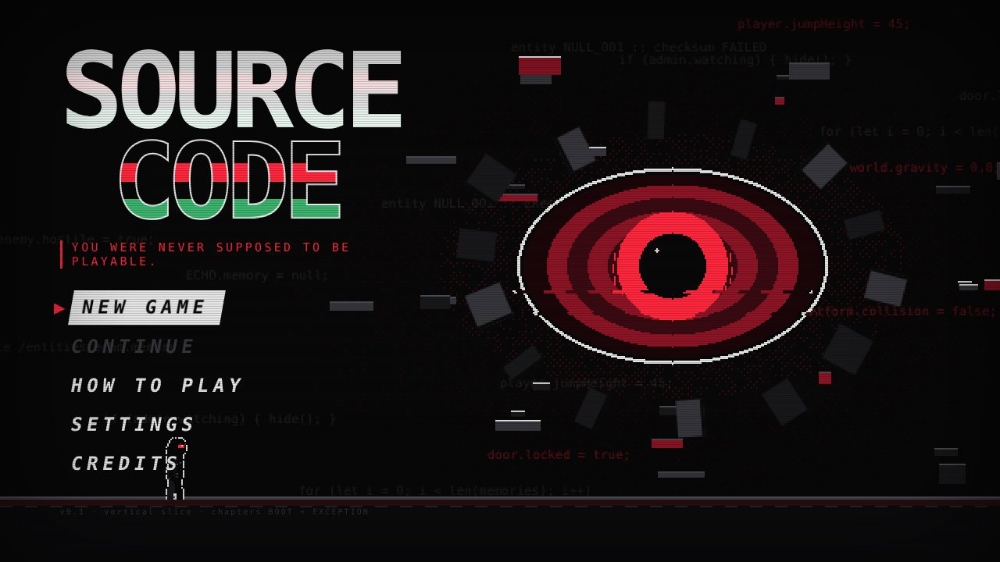
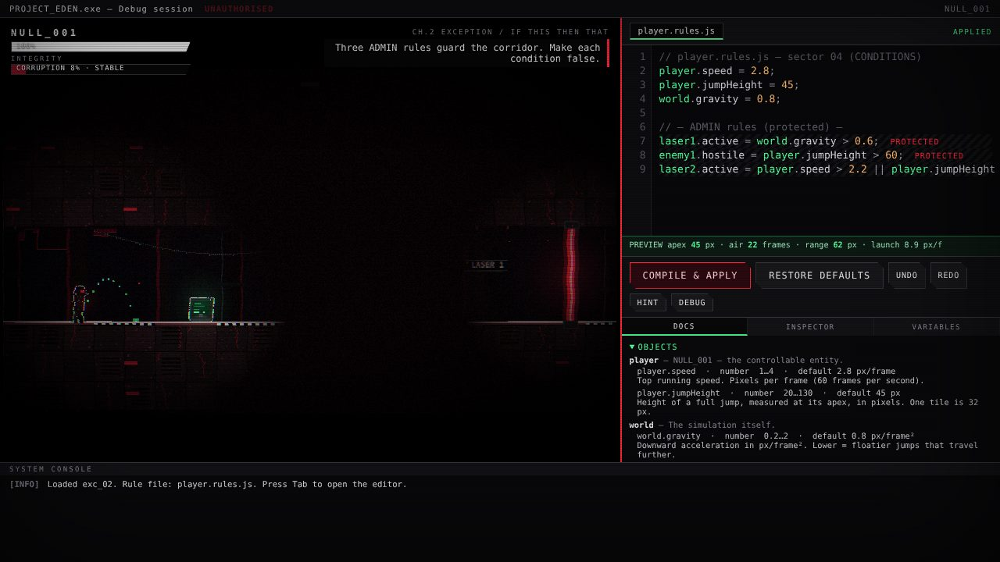

# SOURCE CODE

> *You were never supposed to be playable.*

A psychological-horror programming platformer. You are **NULL**, a faceless entity with one crimson eye, trapped in **PROJECT EDEN**. The simulation's rules are written in code — and you can edit them. Rewrite gravity, jump height, doors, lasers and the enemies that guard them through a sandboxed rule language, while **ADMIN** watches, **ECHO** whispers and corruption spreads.




## Play
Deployed build: **https://mikey-0000.github.io/source-code/** (once GitHub Pages is enabled — see below).

Run locally (Node 20+):
```bash
npm install
npm run dev        # http://localhost:5173 style dev server with watch
npm run build      # outputs dist/
npm test           # 36 unit + puzzle-solvability tests
npm run test:e2e   # Playwright browser test (needs Chrome; CHROME_PATH to override)
```
Append `?skipboot=1` to skip the boot sequence.

> **New here?** Read the [Player guide](docs/PLAYER_GUIDE.md) (also available in-game: *HOW TO PLAY* on the title and pause menus). Press **J** in-game for the infinite-jump assist.

## Controls
| Action | Keys |
|---|---|
| Move / Jump | A D or ←→ / Space or W |
| Interact (terminals, dialogue) | E |
| Open / close source editor | Tab |
| Compile & apply rules | Ctrl+Enter |
| Pause | Esc |
| Infinite jump (assist) on/off | J |
All keys are rebindable in Settings. Click an object in the debug view to inspect it.

## The rule language
```js
player.speed = 3.5;
player.jumpHeight = 120;          // px
world.gravity = 0.3;
if (player.jumpHeight > 60) { enemy1.hostile = false; }
for (let i = 0; i < len(plats); i++) { plats[i].solid = true; }
```
Features unlock chapter by chapter (numbers → booleans → conditions → variables → loops → arrays → functions). Everything runs in a sandboxed interpreter (no `eval`), changes apply atomically, and ADMIN's protected lines cannot be edited. Every change raises **corruption**, which changes the world (cameras, hidden memories, a hunter).

## What's in the vertical slice
Chapter 1 **BOOT** (2 levels) and Chapter 2 **EXCEPTION** (3 levels + THE WATCHER boss): 8+ puzzles, EDEN OS (files, terminal, processes), accessibility options (reduced motion, no flashes, high contrast, text scale, CRT toggle, rebinding), procedural audio, saves with checksum/backup.

## Honest status
This is a vertical slice, **not** the full six-chapter game. See [docs/KNOWN_LIMITATIONS.md](docs/KNOWN_LIMITATIONS.md) for everything unimplemented and the stack deviations, [docs/TEST_REPORT.md](docs/TEST_REPORT.md) for what was and wasn't verified, [docs/ARCHITECTURE.md](docs/ARCHITECTURE.md) for design, and [docs/ASSET_MANIFEST.md](docs/ASSET_MANIFEST.md) for assets (all procedural, original).

## Deploying
`.github/workflows/deploy.yml` typechecks, tests, builds and publishes `dist/` to GitHub Pages on every push to `main`. One-time setup: repository **Settings → Pages → Source: GitHub Actions**. For Cloudflare Pages: build command `npm run build`, output directory `dist`.

## Credits
Design, code, art and audio: generated for this project; all assets are original and procedural. Created with Claude.
